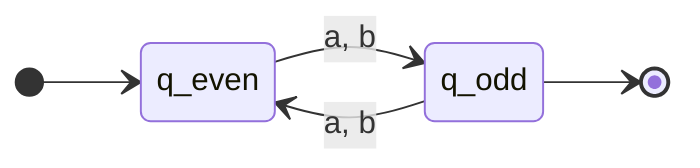

## Chapter 1
### Notes
$\Sigma:$ Alphabet identifier $\Sigma = \{\lambda, a, b, aa, ab, ba, bb\}$
$\lambda :$ Empty string
$S^*:$ Kleene star, all possible concatenations
$|x|:$ length
$xy:$ concatenation
$x^n:$ repetition
$x^R :$ reversal
Formal grammar: substitution rules that can generate all strings in a formal language
### Chapter 1 Exercises
1. List in canonical order the first 11 elements of the subset of $\{0, 1\}^∗$ that are of odd length.
$\{0, 1, 000, 001, 010, 011, 100, 101, 110, 111, 00000 \}$
2. List the first 11 elements of $S = \{aba, ba\}^∗$ in canonical order. (Note: the alphabet here is $\{a, b\}$, but the set $S$ is being operated upon by the Kleene star.)
$\{\lambda, ba, aba, baba, ababa, baaba, abaaba, bababa, abababa, baababa, babaaba \}$
3. Draw a finite automaton that accepts all the strings of odd length over $\Sigma = \{a, b\}$.

4. Write a formal grammar that generates all strings of odd length over $\Sigma = \{a, b\}$.
$O \rightarrow aE|bE$
$E \rightarrow aO|bO|\lambda$

### Notes
#### Non-deterministic finite automatons (NFAs)
Lambda closure: set containing the state along with all other states reachable from the state via one or more consecutive lambda transitions (consuming no input)
Jail state: cannot leave

