### 2.1 Exercises
1. Draw a transition graph for the following DFA.

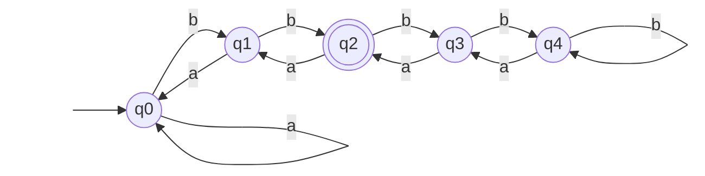
2. Draw transition graphs for DFAs that accept the following languages:
	a. Strings over $Σ = {0, 1}$ that begin with 1 and end with 0.
	```mermaid
	graph LR
	   
    start[ ] --> q0
    style start fill:none,stroke:none

    q0((q0))
    q1((q1))
    q2(((q2)))
    q3((q3))

    q0 -->|1| q1
    q0 -->|0| q3
    q1 -->|1| q1
    q1 -->|0| q2
    q2 -->|0| q2
    q2 -->|1| q1
    q3 -->|0, 1| q3
	```
	b. Strings over $Σ = {a, b}$ where the substring aa occurs at least twice.
	```mermaid
	graph LR
		start[ ] --> q0
		style start fill:none,stroke:none
		
		q0((q0))
		q1((q1))
		q2((q2))
		q3((q3))
		q4(((q4)))
		
		q0 -->|a| q1
		q0 -->|b| q0
		q1 -->|a| q2
		q1 -->|b| q0
		q2 -->|a| q3
		q2 -->|b| q2
		q3 -->|a| q4
		q3 -->|b| q2
		q4 -->|a,b| q4
	```
	c. Strings over $Σ = {a, b, c}$ where every $b$ is followed immediately by at least one $c$. Any
string of $a$s and $c$s is accepted if there are no $b$s at all in the string.
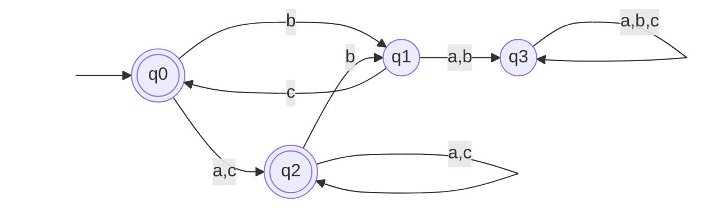
4. The following “incomplete” DFA accepts all strings matching the pattern $a∗baba∗$, but there are edges missing. Complete the DFA by adding a jail state and the missing edges.

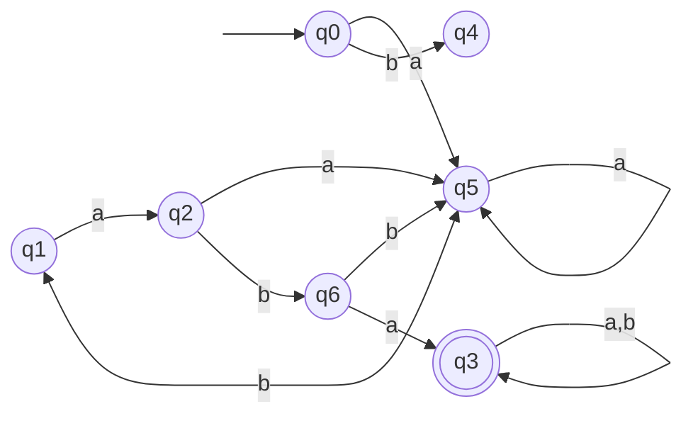
5. Draw a DFA for the language of all strings over $Σ = {a, b}$ that do not have two consecutive $b$s.
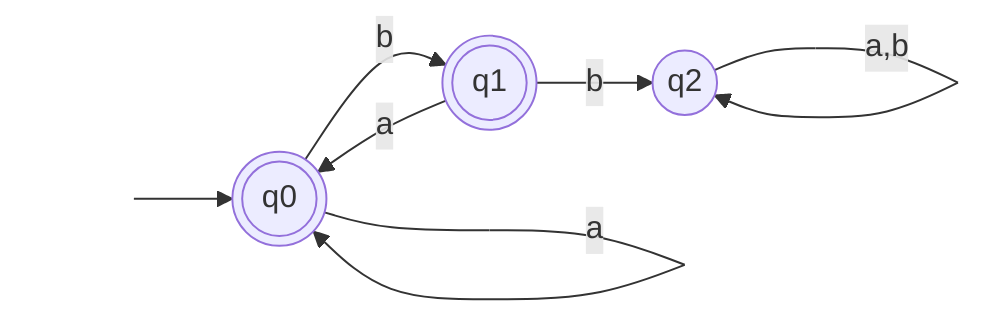
6. Define the transition function, $δ$, for the DFA in the previous problem.
$\delta(q_0, a) = q_0$
$\delta(q_0, b) = q_1$
$\delta(q_1, a) = q_0$
$\delta(q_1, b) = q_2$
$\delta(q_2, a) = q_2$
$\delta(q_2, b) = q_2$
7. Draw a DFA for the language of all strings over $Σ = {a, b}$ where no two adjacent symbols
are the same. For example, $bab$ and $ababa$ are in the language, but aa and abb are not.
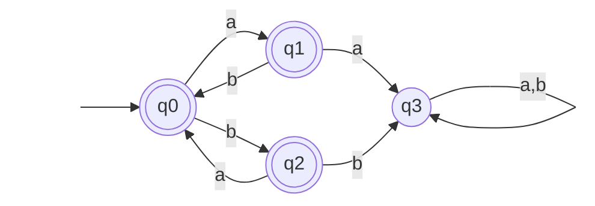
8. Draw a DFA for the language of all strings over $Σ = {a, b}$ that have an even number of $a$s
and an even number of $b$s. (Hint: You only need four states.)
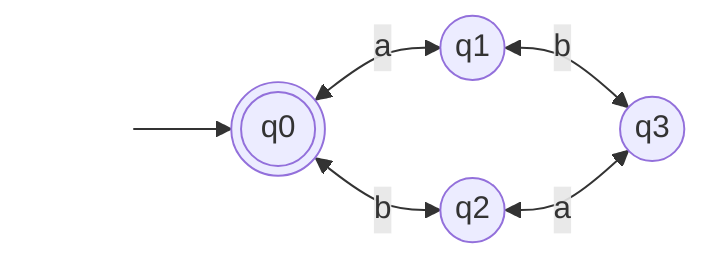
9. Following Example 2–8, draw a DFA that accepts all bit strings that represent numbers congruent to 3 mod 4.
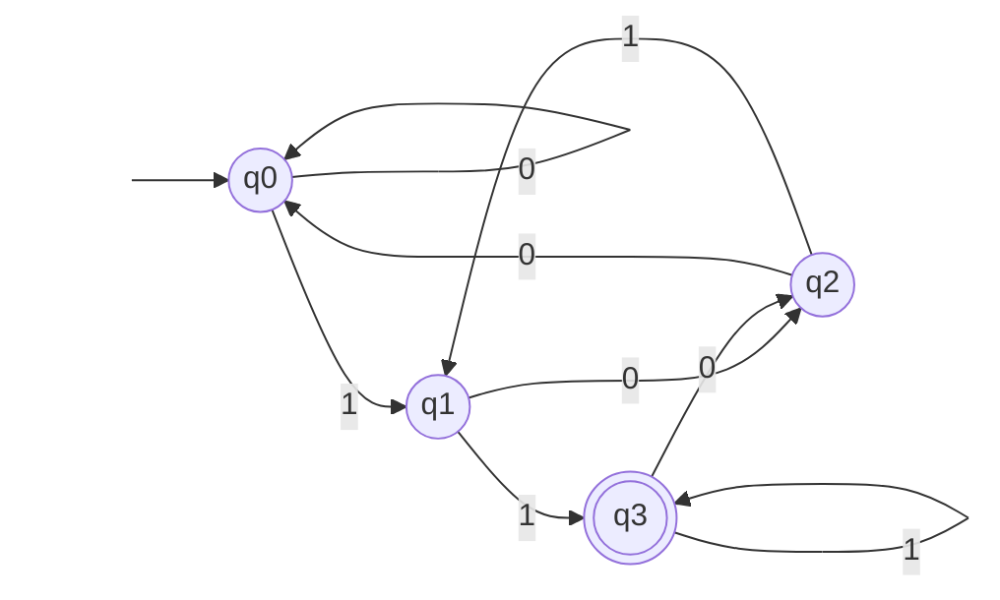
10. Draw a DFA that accepts all bit strings that represent numbers congruent to 3 mod 5.
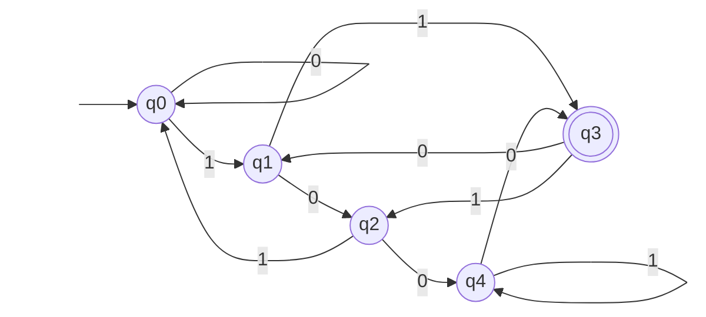

### 2.2 Exercises
1. List all possible paths in the automaton in Figure 2–16 (Example 2–11) that accept the string
$abbbaa$.
![[Pasted image 20260519161641.png|279]]
$q0,q0,q0,q0,q0,q1,q3$
$q0,q0,q0,q0,q2,q3,q3$
$q0,q0,q0,q2,q3,q3,q3$
$q0,q0,q2,q3,q3,q3,q3$
2. Draw a NFA for the language of all strings over $Σ = {a, b}$ that begin and end with the same symbol, (similar to example 2–10), but without the restriction that the string is at least length 2—that is, the strings $λ, a, b$ should also be accepted.
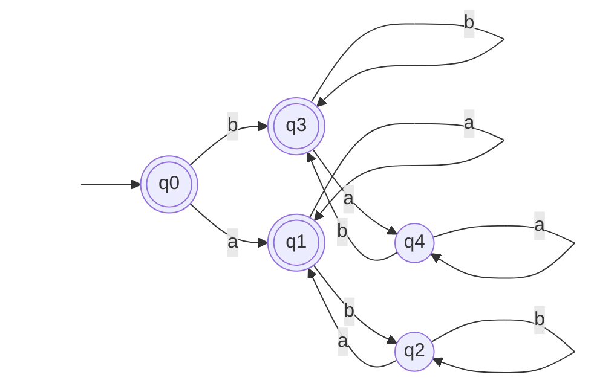
The following NFA pertains to problems 3–5.
![[Pasted image 20260519161544.png|310]]
3. What language does this NFA represent?
$L=\{\lambda, b, ba, baa, bab,...\}$, or all strings over alphabet $\Sigma = \{a,b\}$ that start with $b$.
4. Convert this NFA to a DFA using the tabular method shown in this section.

| States         | a              | b              |
| -------------- | -------------- | -------------- |
| $\to\{q_0\}$   | $\phi$         | $+\{q_1,q_2\}$ |
| $+\{q_1,q_2\}$ | $+\{q_0,q_2\}$ | $\phi$         |
| $+\{q_0,q_2\}$ | $\phi$         | $+\{q_1,q_2\}$ |
| $\phi$         | $\phi$         | $\phi$         |


5. Draw the transition graph for the DFA from the previous problem.
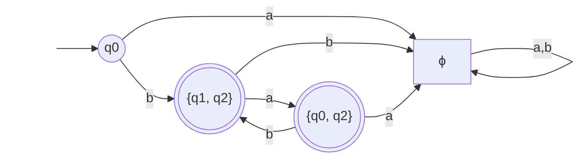
5. Draw an NFA that accepts all strings over $Σ = {a, b}$ that either end in $ab$ or contain the substring $bb$.
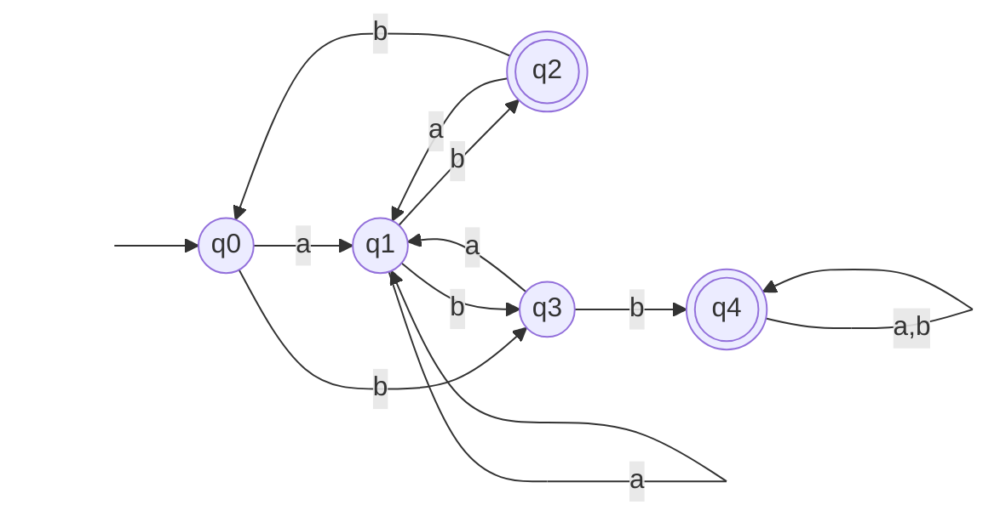

### 2.3 Exercises
1. Show that the DFA in Figure 2–9 is minimal.
![[Pasted image 20260525161410.png|314]]
All states are reachable, so the first check has passed. 

Non-final nodes: {0, 1, 10, 11}
Given a 0:
0 -> 0 (non-final)
1 -> 10 (non-final)
10 -> 100 (final)
11 -> 110 (final)
**{0, 1}, {10, 11}**
Given a 1:
0 -> 1
1 -> 11
Different groups, so they split
***{0}, {1}***
10 -> 101
11 -> 111
Different groups (next step) so they split
***{10}, {11}***
Final nodes: {100, 101, 110, 111}
Given a 0:
100 -> 0 (non-final)
101 -> 10 (non-final)
110 -> 100 (final)
111 -> 110 (final)
**{100, 101}, {110, 101}**
Given a 1:
100 -> 1 
101 -> 11
Different groups, so they split
***{100}, {101}***
110 -> 101
111 -> 111
Different groups, so they split
***{110}, {111}***
Because all can be split into separate states, the DFA is minimal.

2. Minimize the DFA defined by the transition function below. The accepting states are
$\{q_3, q_4, q_8, q_9\}$.
$δ(q0, a) = q1, δ(q0, b) = q9$
$δ(q1, a) = q8, δ(q1, b) = q2$
$δ(q2, a) = q3, δ(q2, b) = q2$
$δ(q3, a) = q2, δ(q3, b) = q4$
$δ(q4, a) = q5, δ(q4, b) = q8$
$δ(q5, a) = q4, δ(q5, b) = q5$
$δ(q6, a) = q7, δ(q6, b) = q5$
$δ(q7, a) = q6, δ(q7, b) = q5$
$δ(q8, a) = q1, δ(q8, b) = q3$
$δ(q9, a) = q7, δ(q9, b) = q8$

Accepting: $\{q_3, q_4, q_8, q_9\}$
Non-accepting: {$q_0,q_1,q_2,q_5,q_6,q_7$}

Accepting:
q3 > na, a
q4 > na, a
q8 > na, a
q9 > na, a
No splits, so {q3, q4, q8, q9} stays a group

Non-accepting:
q0 > na, a
q1 > a, na
q2 > a, na
q5 > a, na
q6 > na, na
q7 > na, na
Splits into {q0}, {q1, q2, q5}, {q6, q7}

q1 > {q3, q4, q8, q9},  {q1, q2, q5}
q2 > {q3, q4, q8, q9},  {q1, q2, q5}
q5 > {q3, q4, q8, q9},  {q1, q2, q5}
No splits

q6 > {q6, q7}, {q1, q2, q5}
q7 >  {q6, q7}, {q1, q2, q5}
No splits

q3 > {q1, q2, q5}, {q3, q4, q8, q9}
q4 > {q1, q2, q5}, {q3, q4, q8, q9}
q8 > {q1, q2, q5}, {q3, q4, q8, q9}
q9 > {q6, q7}, {q3, q4, q8, q9}
Split out q9

Minimized DFA:

| **Current State**         | **Input a**           | **Input b**           |
| ------------------------- | --------------------- | --------------------- |
| **$\rightarrow \{q_0\}$** | $\{q_1, q_2, q_5\}$   | $* \{q_9\}$           |
| **$\{q_1, q_2, q_5\}$**   | $* \{q_3, q_4, q_8\}$ | $\{q_1, q_2, q_5\}$   |
| **$\{q_6, q_7\}$**        | $\{q_6, q_7\}$        | $\{q_1, q_2, q_5\}$   |
| $*\{q_3, q_4, q_8\}$      | $\{q_1, q_2, q_5\}$   | $* \{q_3, q_4, q_8\}$ |
| $*\{q_9\}$                | $\{q_6, q_7\}$        | $* \{q_3, q_4, q_8\}$ |

3. Find a minimal DFA for the following NFA.
![[Pasted image 20260525161255.png|414]]
NFA:

| States    | 0             | 1      |
| --------- | ------------- | ------ |
| $\to q_0$ | $\{q_0,q_1\}$ | $q_1$  |
| $q_1$     | $q_2$         | $q_2$  |
| $q2$      | $\phi$        | $q_2$  |
| $\phi$    | $\phi$        | $\phi$ |
DFA:

| **States**                | **0**                | **1**           |
| ------------------------- | -------------------- | --------------- |
| **$\rightarrow \{q_0\}$** | $\{q_0, q_1\}$       | $*\{q_1\}$      |
| **$*\{q_1\}$**            | $\{q_2\}$            | $\{q_2\}$       |
| **$*\{q_0, q_1\}$**       | $*\{q_0, q_1, q_2\}$ | $*\{q_1, q_2\}$ |
| **$\{q_2\}$**             | $\phi$               | $\{q_2\}$       |
| **$*\{q_1, q_2\}$**       | $\{q_2\}$            | $\{q_2\}$       |
| **$*\{q_0, q_1, q_2\}$**  | $*\{q_0, q_1, q_2\}$ | $*\{q_1, q_2\}$ |
| **$\phi$**                | $\phi$               | $\phi$          |
Minimal DFA: 
Non-accepting:
{q0, q2, $\phi$}

Accepting:
{q1, {q0, q1}, {q1, q2}, {q0, q1, q2}}

| States                    | 0   | 1   |
| ------------------------- | --- | --- |
| **$\rightarrow \{q_0\}$** | na  | a   |
| **$\{q_2\}$**             | na  | na  |
| **$\phi$**                | na  | na  |
q0 -> na1
{q2, $\phi$} -> na2

| States                   | 0   | 1   |
| ------------------------ | --- | --- |
| **$*\{q_1\}$**           | na2 | na2 |
| **$*\{q_0, q_1\}$**      | a   | a   |
| **$*\{q_1, q_2\}$**      | na2 | na2 |
| **$*\{q_0, q_1, q_2\}$** | a   | a   |

q1, {q1, q2} -> a1
{q0, q1}, {q0, q1, q2} -> a2

| States                   | 0   | 1   |
| ------------------------ | --- | --- |
| **$*\{q_0, q_1\}$**      | a2  | a1  |
| **$*\{q_0, q_1, q_2\}$** | a2  | a1  |

| **State**                                  | **0**                                  | **1**                        |
| ------------------------------------------ | -------------------------------------- | ---------------------------- |
| **$\rightarrow \{\{q_0\}\}$**              | $*\{\{q_0, q_1\}, \{q_0, q_1, q_2\}\}$ | $*\{\{q_1\}, \{q_1, q_2\}\}$ |
| **$\{\{q_2\}, \phi\}$**                    | $\{\{q_2\},\phi\}$                     | $\{\{q_2\},\phi\}$           |
| **$*\{\{q_1\}, \{q_1, q_2\}\}$**           | $\{\{q_2\}, \phi\}$                    | $\{\{q_2\},\phi\}$           |
| **$*\{\{q_0, q_1\}, \{q_0, q_1, q_2\}\}$** | $*\{\{q_0, q_1\}, \{q_0, q_1, q_2\}\}$ | $*\{\{q_1\}, \{q_1, q_2\}\}$ |
### Section 2.4 Exercises
Draw a Mealy machine that reads ones and zeroes and prints a one every time the substring 1001 is recognized. For example, the input 01001001 yields 00001001.
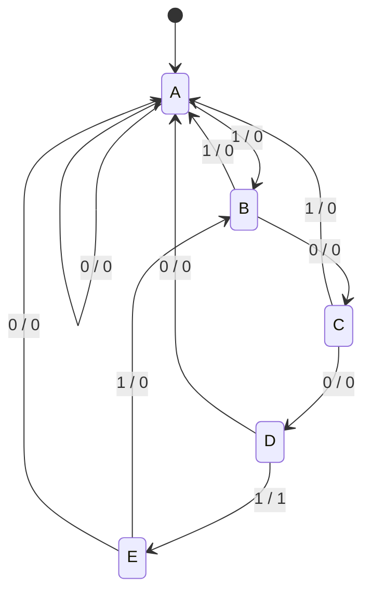
Draw a Mealy machine that performs a circular shift-left operation on strings of a’s and b’s with an end-of-string delimiter, so that $abaab$ yields the string $baaba$.
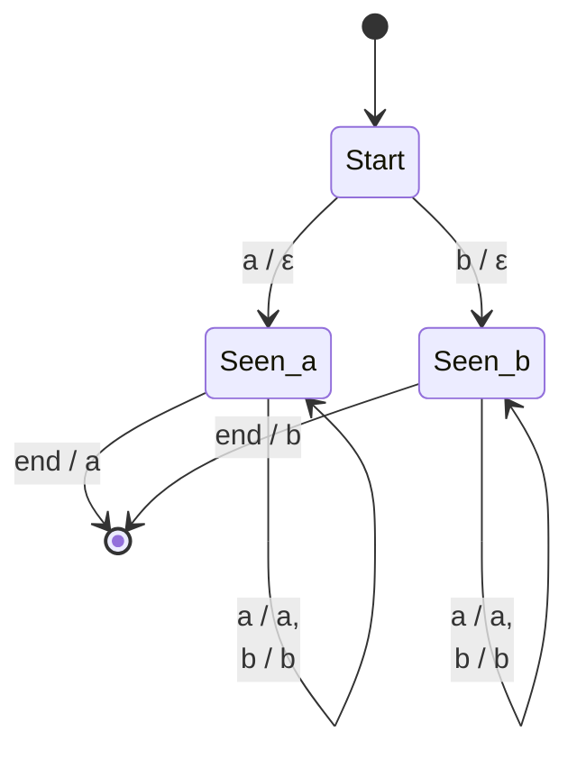
Use the procedure described at the end of this section to minimize the following Mealy machine.
![[Pasted image 20260527231450.png]]

q0 (q1.1, q2.1)
q1 (q3.1, q3.0)
q2 (q3.1, q3.0)
q3 (q4.0, q4.0)
q4 (q3.1, q3.1)

Because of output: {q0, q4}, {q1, q2}, {q3}
Adding in destinations: {q0}, {q4}, {q1, q2}, {q3}
After another loop, there are no more changes.

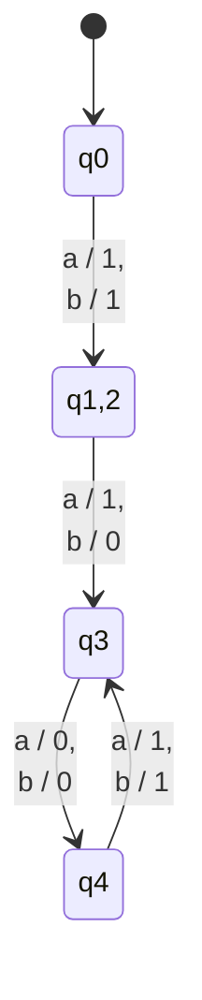