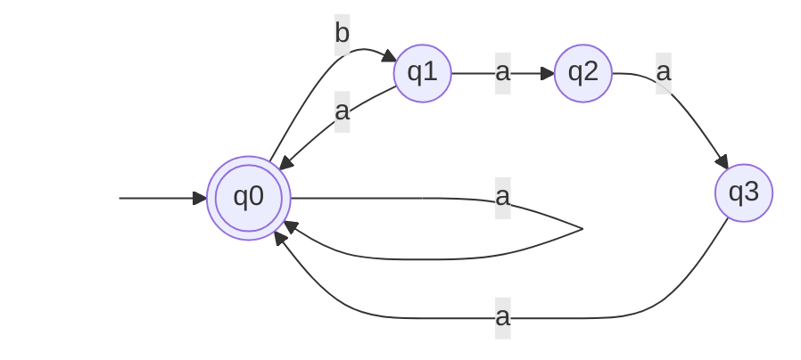
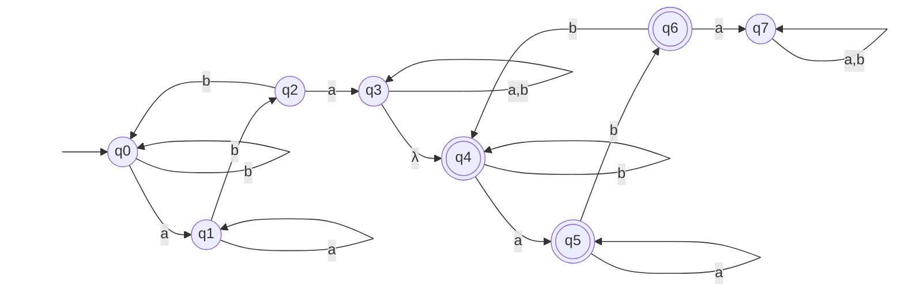
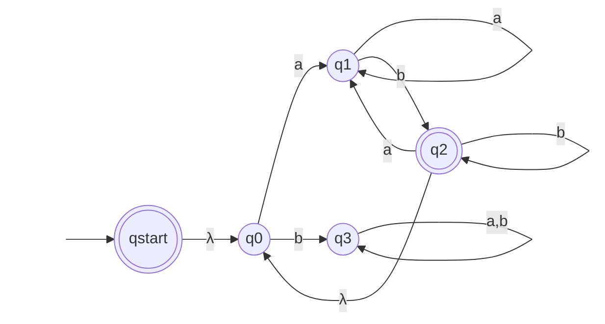

## Homework
### 3.1 Exercises
1. Write a regular expression for the language of strings over Σ = {a,b} containing exactly two a’s. 
$b^*ab^*ab^*$
2. Write a regular expression for the language of strings over Σ = {0,1} that have an odd number of 1’s.
$0^*10^*(10^*10^*)^*$
3. Write a regular expression for the language of strings over Σ = {a,b} whose length is a multiple of 3.
$((a+b)(a+b)(a+b))^*$
4. Write a regular expression for the language with strings of the form anbm where m and n have the same parity (i.e., the numbers of a’s and b’s are either both even or both odd simultaneously). 
$(aa)^* (bb)^* + a(aa)^* b(bb)^*$
5. Write a regular expression over Σ = {0,1} where the bit strings represent 0 or a positive, even number. Leading zeroes are not allowed, except for the number 0 itself.
$0 + 1(0+1)^*0$
6. Write a regular expression for the language of strings over Σ = {0,1} where the symbols alternate between 0 and 1 (e.g., 0, 1, … 0101,01010,1010,10101). 
$(0+\lambda)(10)^*(1+\lambda)$

### 3.2 Exercises
1. Find a NFA for the regular expression $a^∗(b(a + aaa))^∗$.

2. Using the state-bypass and elimination technique, convert the FA in Figure 2–17 (repeated below) to a regular expression. (*Oops, did this on accident*)
![[Pasted image 20260602225041.png|204]]
$(a(a+b)^*a + b(a+b)^*b)$
3. Using the state-bypass and elimination technique, convert the FA in Figure 2–21 (repeated below) to a regular expression.
![[Pasted image 20260602225051.png|264]]
$(a(b^*aa^*b)^*b^*aa^* + b(a^*bb^*b)^*a^*bb^*)$
4. Find a NFA that accepts the concatenation of the language accepted by the machine in Figure 2–6 followed by the machine in Figure 2–5. (Machines repeated below.)
![[Pasted image 20260602225131.png|492]]
![[Pasted image 20260602225146.png|497]]

5. Find a NFA that accepts the Kleene star of the language accepted by the machine in Figure 2–7.
![[Pasted image 20260602225340.png|327]]

### 3.3 Exercises
1. Find a Right-linear grammar for the machine in Exercise 2.1.4 (repeated below). ![[Pasted image 20260606123853.png]]
$q_0 \rightarrow aq_0 | bq_1$
$q_1 \rightarrow aq_2$
$q_2 \rightarrow bq_3$
$q_1 \rightarrow aq_3$

2. Find a Left-linear grammar for the machine in Exercise 1 above.
$q_3 \rightarrow q_2b | q_3a$
$q_2 \rightarrow q_1a$
$q_1 \rightarrow q_0b$
$q_0 \rightarrow q_0a | \lambda$
3. Find a Left-linear grammar that generates the same language as the following Right-linear grammar.
$S → bS | aX$
$X → aX | bY$
$Y → aX | bS | λ$

$Y \rightarrow Xb$
$S \rightarrow Sb|Yb|\lambda$
$X \rightarrow Sa|Ya|Xa$

2. Find a Right-linear grammar for the language of the following Left-linear grammar.
$S → Sa | Sb | Za$
$Z → Y b$
$Y → Y a | Xa$
$X → Xb | Zb | λ$

$X → bX | aY$
$Z → bX|aS$
$Y → aY | bZ$
$S → aS | bS|\lambda$

