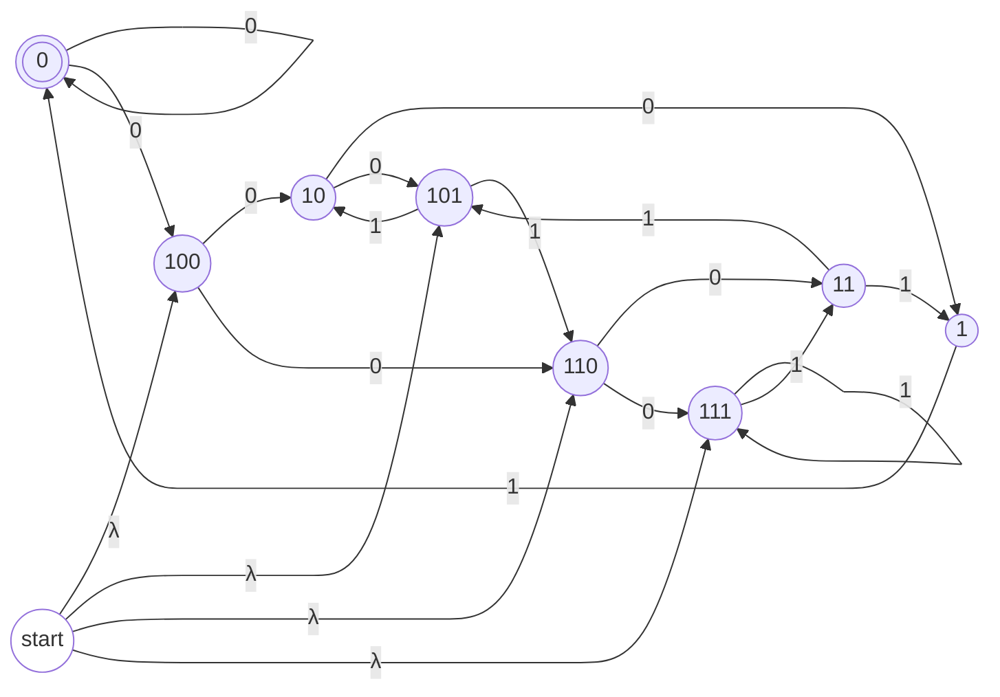
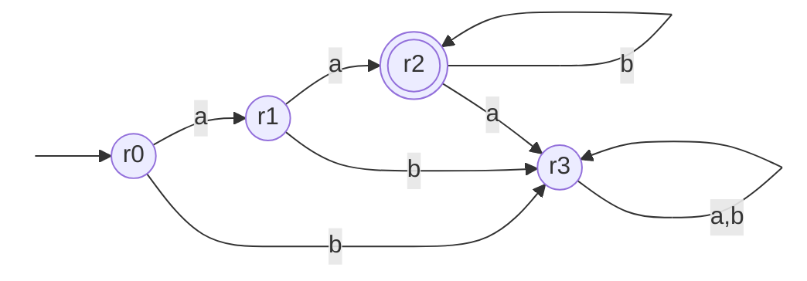
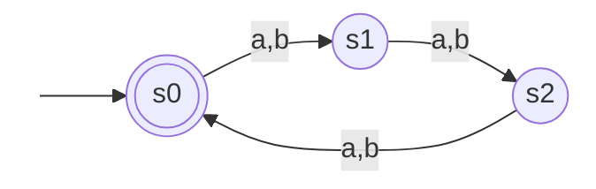

## Section 4.1 Exercises
1. Find a NFA that accepts the reversal of the language of the machine in Figure 2–9 (repeated below) by reversing the DFA in that figure:
![[Pasted image 20260609185107.png|379]]

2. Construct the product table for the language $R = aab^∗$ and the language S, which contains all strings of a’s and b’s whose length is a multiple of 3. (Use state names $r0, r1, …$ and $s0, s1…$). You will use this in the problems that follow.

| State          | $a$            | $b$            |
| -------------- | -------------- | -------------- |
| $\{r_0, s_0\}$ | $\{r_1, s_1\}$ | $\{r_3, s_1\}$ |
| $\{r_1, s_1\}$ | $\{r_2, s_2\}$ | $\{r_3, s_2\}$ |
| $\{r_3, s_1\}$ | $\{r_3, s_2\}$ | $\{r_3, s_2\}$ |
| $\{r_2, s_2\}$ | $\{r_3, s_0\}$ | $\{r_2, s_0\}$ |
| $\{r_3, s_2\}$ | $\{r_3, s_0\}$ | $\{r_3, s_0\}$ |
| $\{r_3, s_0\}$ | $\{r_3, s_1\}$ | $\{r_3, s_1\}$ |
| $\{r_2, s_0\}$ | $\{r_3, s_1\}$ | $\{r_2, s_1\}$ |
| $\{r_2, s_1\}$ | $\{r_3, s_2\}$ | $\{r_2, s_2\}$ |

2. Which composite states from your product table must accept for $R ∪ S$?
$[\{r_0, s_0\},\{r_2, s_2\}, \{r_2, s_0\}, \{r_2, s_1\}, \{r_3, s_0\}]$
3. Which composite states from your product table must accept for $R ∩ S$?
$[\{r_2, s_0\}]$
4. Which composite states from your product table must accept for $R − S$?
$[\{r_2, s_1\},\{r_2, s_2\}]$
5. Which composite states from your product table must accept for $S − R$?
$[\{r_0, s_0\},\{r_3, s_0\}]$
6. Which composite states from your product table must accept for $R ⊖ S$?
$[\{r_0, s_0\},\{r_3, s_0\},\{r_2, s_1\},\{r_2, s_2\}]$

## Section 4.2 Exercises
Prove whether or not the following two DFAs accept the same language.
![[Pasted image 20260613220502.png]]

| State          | $a$            | $b$            |
| -------------- | -------------- | -------------- |
| $\{r_0, s_0\}$ | $\{r_1, s_1\}$ | $\{r_2, s_2\}$ |
| $\{r_1, s_1\}$ | $\{r_0, s_2\}$ | $\{r_2, s_0\}$ |
| $\{r_2, s_2\}$ | $\{r_0, s_0\}$ | $\{r_0, s_1\}$ |
| $\{r_0, s_2\}$ | $\{r_1, s_0\}$ | $\{r_2, s_1\}$ |
| $\{r_1, s_0\}$ | $\{r_0, s_1\}$ | $\{r_2, s_2\}$ |
| $\{r_2, s_1\}$ | $\{r_1, s_2\}$ | $\{r_0, s_0\}$ |
| $\{r_1, s_2\}$ | $\{r_0, s_0\}$ | $\{r_0, s_1\}$ |
In row 2, we see that r0 and s2 are in the same pair. However, one is accepting and one is not. This shows that there is at least one string that is accepted by one and not the other.

Prove whether or not the following two DFAs accept the same language.
![[Pasted image 20260613220515.png]]

| State          | $a$            | $b$            |
| -------------- | -------------- | -------------- |
| $\{r_0, s_0\}$ | $\{r_1, s_0\}$ | $\{r_4, s_1\}$ |
| $\{r_1, s_0\}$ | $\{r_1, s_0\}$ | $\{r_2, s_1\}$ |
| $\{r_4, s_1\}$ | $\{r_3, s_2\}$ | $\{r_4, s_1\}$ |
| $\{r_2, s_1\}$ | $\{r_3, s_2\}$ | $\{r_2, s_1\}$ |
| $\{r_3, s_2\}$ | $\{r_3, s_2\}$ | $\{r_3, s_2\}$ |
Because at none of the rows to we see states that are accepting and unaccepting paired up, we can prove that the two DFAs accept the same language.

Prove whether or not the language accepted by the first DFA below is a subset of the language of the second DFA.
![[Pasted image 20260613220534.png]]

| State          | $a$            | $b$            |
| -------------- | -------------- | -------------- |
| $\{r_0, s_0\}$ | $\{r_1, s_1\}$ | $\{r_2, s_0\}$ |
| $\{r_1, s_1\}$ | $\{r_1, s_1\}$ | $\{r_2, s_0\}$ |
| $\{r_2, s_0\}$ | $\{r_1, s_1\}$ | $\{r_2, s_0\}$ |
Because in no case does the first DFA accept a string that the second DFA does not (in other words, there are no {accept, reject} pairs in the product table), we can prove that the first DFA is a subset of the second.

Does the following DFA accept any strings? Prove your result.
![[Pasted image 20260613220552.png]]
No. Because there is no route from $r_0$ , the entry point, to $r1$, the only accepting point, the DFA cannot accept any strings. $r_0$ only leads to other outer edges, and those outer edges only lead to each other, leaving it impossible to access the middle where $r_1$ is.

## Section 4.3 Exercises
1. Using the Pumping Theorem, show that the language $a^mb^m$ where $m$ is a perfect cube, is not regular.
First, we assume the language is regular. We will ensure $m$ is a perfect cube, and call it $p^3$. 
The string is now $s = a^{p^3} b^{p^3}$. Its total length is $2p^3$, which is clearly greater than or equal to $p$. 
The $y$ substring starts with many copies of $a$ because $|xy| \le p$. 
Now, we check if $xy^*z \in L$ for all $i \ge 0$.
With $xy^2z$, we inject many more copies of $a$ into the first part of string, but not the rest. This upsets the balance of $n$ and $m$, and we no longer have the same amount in each string. 
Because our pumped string broke the rules of the language, it cannot be regular.
2. Show that the language $\{n_a(w) \ne n_b(w) | w ∈ (a + b)^∗\}$ is not regular.
This language represents a set of all strings where there is a different amount of $a$s and $b$s. 
If a language is regular, its complement must also be regular. 
$\overline{L} = \{w \in (a + b)^* \mid n_a(w) = n_b(w)\}$
Because two regular languages intersected result in a regular language, we can intersect $\overline{L}$ with $a^* b^*$ (clearly regular) to get $a^n b^n$. This makes it so that all numbers come one after another.
$a^n b^n$ is clearly not regular because a finite machine cannot count any number of $a$s and $b$s to ensure that they always match. 
Because of this, our original language cannot be regular.
3. Show that the language $\{a^mb^n\}$ where $\frac{m}{n}$ is a positive integer is not regular.
If our integer = $\frac{m}{n}$, it must follow that $n*$integer = $m$. So, the number of as must equal the number of bs times an integer.
Assuming the language is regular, it must have a specific pumping length, which we'll call $p$. 
Now, we need to choose a string at least $p$ characters long. Let's make the integer we described earlier 2, so we have:
$a^{2p} b^p$ must equal $xyz$
Now, we need to split that string into pieces. $|xy| \le p$, so $x$ and $y$ must contain only $a$s.  
Now, we pump the string. If we set $* = 0$, we have $2p$ - however many $a$s we had in $y$. We have the same amount of $b$s, $p$. 
Does this satisfy the original definition? Well, if the original $\frac{m}{n}/\frac{2p}{p} = 2$, and we subtract the amount of $a$s in $y$ from $2p$, which must be greater than 1, because $y$ cannot be empty, and less than $p$ because $|xy| \le p$, we will end up with a coefficient greater than 1 and less than 2, which is not an integer, betraying the original premise.
4. Show that the language $\{a^{2^n} | n > 0\}$ is not regular.
Pumping length $p > 0$.
$n=p$
$a^{2^p} = xyz$
Pumping our string once results in adding the number of $a$s in $y$ to the total length, which results in a length of greater than $2^p$. 
But how much greater? Well, we can say for sure that it isn't large enough to double the entire string because the length of $y$ must be less than $p$, because $|xy| \le p$. 
Because the string cannot be doubled again when pumping, the pumped string will not fit the original language. 