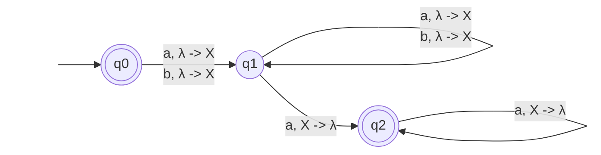
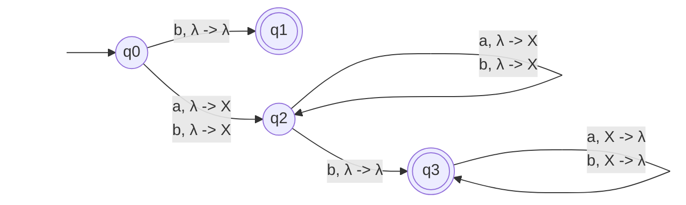
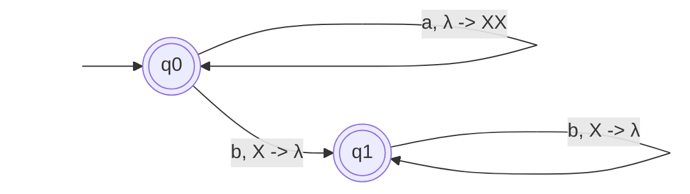
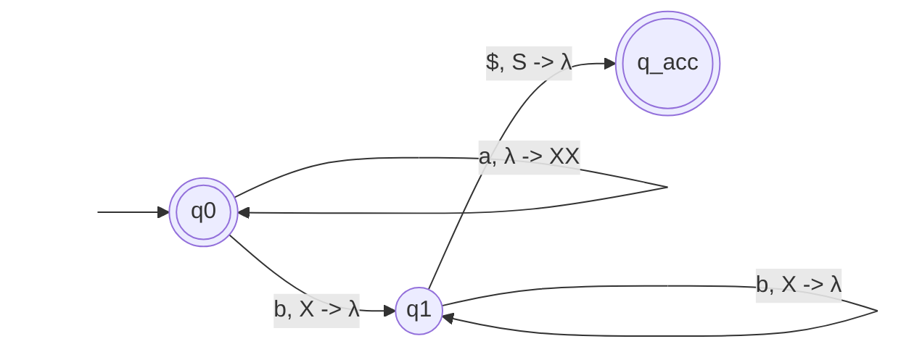
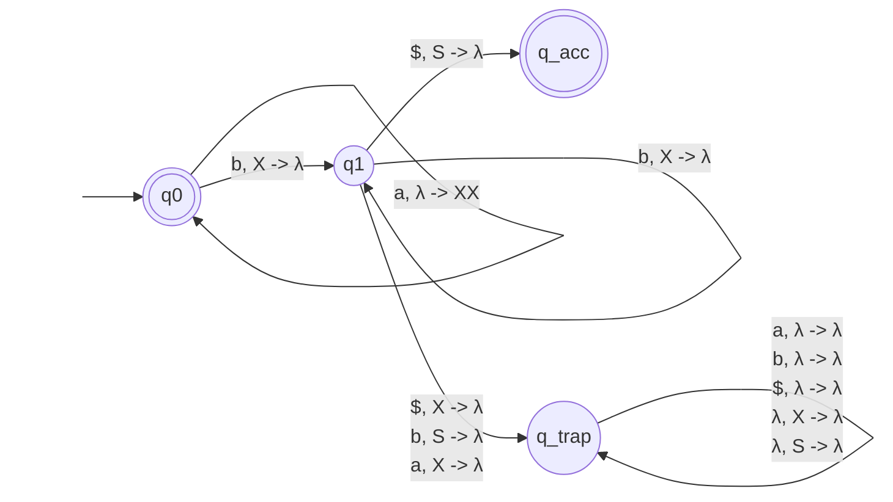
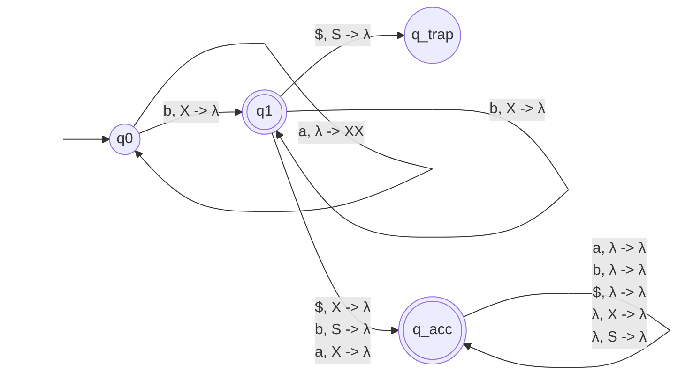

## 5.1 Exercises
1. What language does the following PDA accept?
![[Pasted image 20260620112514.png|298]]
One or more a, then a b, then an amount of as or bs equal to the amount of original as - 1
$L = \{a^n b (a + b)^{n-1} \mid n \ge 1\}$
2. Draw a PDA that accepts the language $𝑤𝑎^{|𝑤|}, 𝑤 ∈ (𝑎 + 𝑏)^∗$.

3. Draw a PDA that accepts all odd-length strings in (𝑎 + 𝑏)∗ that have a 𝑏 in the exact
middle.

5. What language does the following PDA accept?
![[Pasted image 20260620112542.png|431]]
It represents (2a)^n as, then, if you add a b, you subtract from the pool of |a|, and there must also be at least one a, after all of the bs, which string of as also subtracts from the pool of the original |a|. When the two sides are balanced out (or if you only choose to keep the first half of as) the string can be completed.
$L = \{a^n b^m a^k \mid 2n = m + k \text{ where } n \ge 1, m \ge 1, k \ge 1\} \cup \{a^n \mid n \ge 0\}$
## 5.2 Exercise
Find a DPDA for the complement of the language $a^n b^{2n}$. Trace the strings $𝑎𝑎𝑏𝑏𝑏$ and $𝑎𝑎𝑏𝑏𝑏𝑏𝑏$ to show that they are accepted by your complement.
(Hint: Start with Figure 5-3 and add a stack start symbol (S) and use an end-of-string delimiter ($). Add states and edges as needed to make this explicitly deterministic per Definition 5.2. Make sure you empty the stack even for strings not in the language. You don’t have to include processing for impossible cases: e.g., you may assume that no symbols appear after the ending $.
Then form the complement of the DPDA. Only states where the stack will be emptied need to be accepting.)
Only consider possible cases.
The EI states empty the input and the ES state empties the stack.
At the end, we make the ‘end’ state the only accepting state for the complement.

Original (Figure 5.3)

Add accepting state and require an end-of-string delimiter to exit

Add a trap state with only the possible states

Swap accepting and non-accepting states. Final complement complete.

Tracing through the complement DPDA to show correctness:
String $aabbb\$$
- Start: q0. Stack: [S]
- $a$: stay in q0. Stack: [XXS]
- $a$: stay in q0. Stack: [XXXXS]
- $b$: move to q1. Stack: [XXXS]
- $b$: stay in q1. Stack: [XXS]
- $b$: stay in q1. Stack: [XS]
- $\$$: move to q_acc. Stack: [S]
- $\lambda$: stay in q_acc. Stack: []
- q_acc accepts the string
String $aabbbbb\$$
- Start: q0. Stack: [S]
- $a$: stay in q0. Stack: [XXS]
- $a$: stay in q0. Stack: [XXXXS]
- $b$: move to q1. Stack: [XXXS]
- $b$: stay in q1. Stack: [XXS]
- $b$: stay in q1. Stack: [XS]
- $b$: stay in q1. Stack: [S]
- $b$: move to q_acc. Stack: []
- q_acc accepts the string