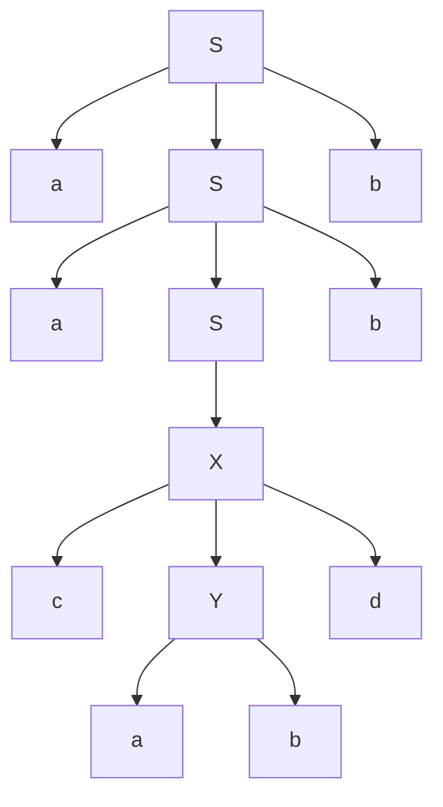
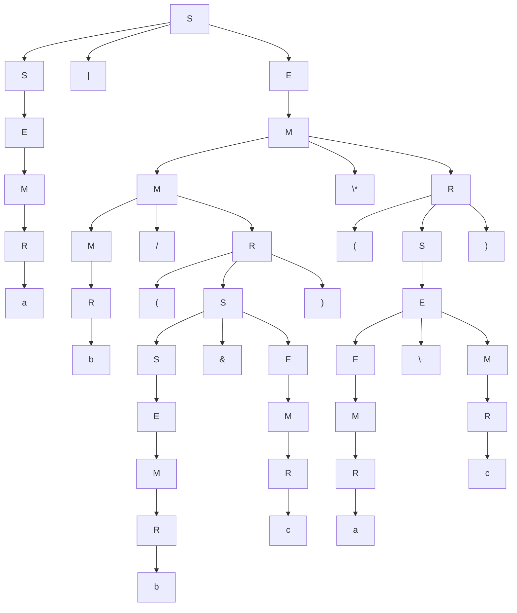
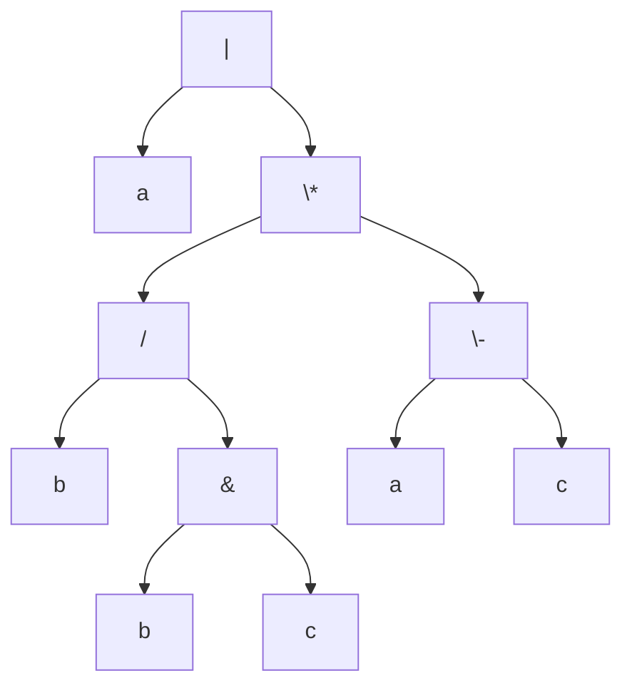
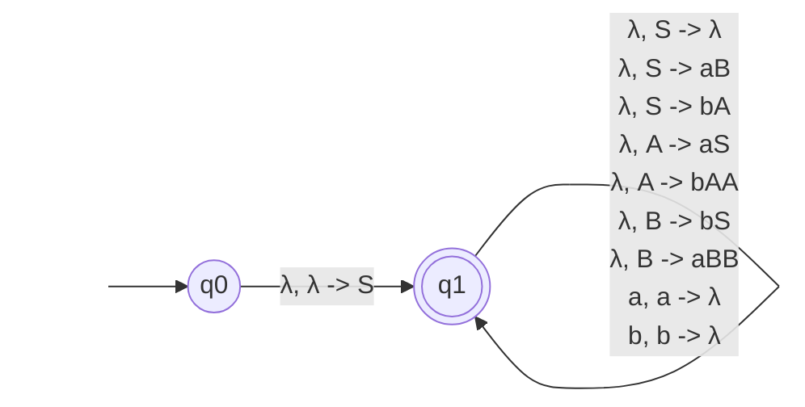
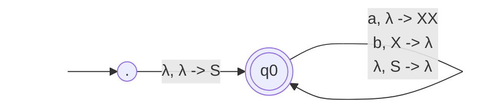
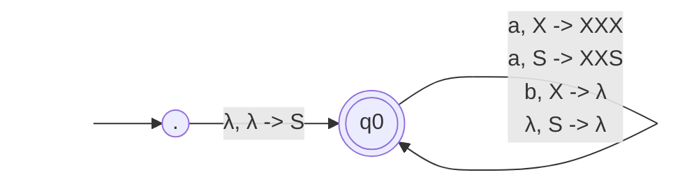
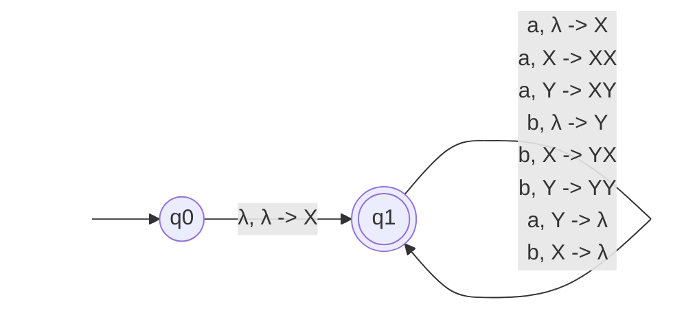

## Section 6.1 Assignment
Find context-free grammars for the languages:
1. $a^n b^n b^m a^m | m, n \ge 0$
$S \rightarrow S_1S_2$
$S_1 \rightarrow aS_1 b|\lambda$
$S_2 \rightarrow bS_2 a |\lambda$
2. $a^n b^m a^m b^n | m, n \ge 0$
$S \rightarrow a A b$
$A \rightarrow bAa|\lambda$
3. $a^n b^m a^q | n=m+q$
$=a^m a^q b^m a^q$
$=a^q a^m b^m a^q$
$S \rightarrow aSa|A$
$A \rightarrow aAb|\lambda$
4. $a^m b^n a^p b^q | m+n=p+q$
$m - q = p - n$
$(m-q=k)=(p-n=k)$
$(m=k+q)=(p=k+n)$
$a^{k+q} b^n a^{k+n} b^q$
$a^k a^q b^n a^k a^n b^q$
$a^q (a^k (b^n a^n) a^k) b^q$
$S \rightarrow aSb|A$
$A \rightarrow aAa|B$
$B \rightarrow bBa|\lambda$
However, k can be negative if $m \lt q$ or $p \lt n$, so we need to adjust our grammar to account for this.
$S \rightarrow S_1|S_2$
(When $m \ge q$):
$S_1 \rightarrow aS_1 b|A$
$A \rightarrow aAa|B$
$B \rightarrow bBa|\lambda$
(When $m \lt q$):
$S_2 \rightarrow aS_2 b|C$
$C \rightarrow bCb|D$
$D \rightarrow bDa|\lambda$
5. Simplify the following CFG:
	$𝐴→0𝐴1 | 0𝐴𝐶 | 0 | 1𝐵0$
	$𝐵→1𝐶0 | 𝐴𝐶$
	$𝐶→1𝐶𝐵 | 𝐴𝐵$
	$𝐷→1𝐴0 | 1$
$A$ and $D$ are safe for now because they terminate
$B$ and $C$ never terminate because they depend on each other, so we can remove them.
	$𝐴→0𝐴1 | 0$
	$𝐷→1𝐴0 | 1$
$D$ is unreachable, so we can remove it.
Final grammar:
	$𝐴→0𝐴1 | 0$
## Section 6.2 Assignment
1. What language is generated by the following CFG?
$𝑆→𝑎𝑆𝑏 | 𝑋$
$𝑋→𝑐𝑋𝑑 | 𝑐𝑌𝑑$
$𝑌→𝑎𝑌𝑏 | 𝑎𝑏$
$L=\{a^n c^m a^p b^p d^m b^n | n \ge 0, m \ge 1, p \ge 1\}$
2. Derive the string 𝑎𝑎𝑐𝑎𝑏𝑑𝑏𝑏 using the grammar in the previous exercise.
$S$
$\Rightarrow aSb$
$\Rightarrow aaSbb$
$\Rightarrow aaXbb$
$\Rightarrow aacYdbb$
$\Rightarrow aacabdbb$
3. Draw the derivation tree for the derivation in the previous exercise.

4. Show that the following grammar for balanced parentheses is ambiguous.
$𝑆→ 𝑆𝑆 | (𝑆) | 𝜆$
Ambiguous means that at least one string can be derived in multiple different ways
Let's derive the string ().
First method:
$S$
$\Rightarrow (S)$
$\Rightarrow (\lambda)$ or $()$
Second method:
$S$
$\Rightarrow SS$
$\Rightarrow S()$
$\Rightarrow \lambda()$ or $()$

5. Modify the grammar below to add rules for subtraction ( – ), division ( / ),
bitwise-or ( | ) and bitwise-and ( & ). The bitwise operations have the same
precedence and are the lowest precedence operators. Subtraction is the same
precedence as addition, and division is the same precedence as multiplication.
You may want to put quotes around the "|" for the bitwise-or to distinguish it
from the normal alternation symbol.
$𝐸→ 𝐸 + 𝑀 | 𝑀$
$𝑀→ 𝑀 ∗ 𝑅 | 𝑅$
$𝑅→(𝐸) | 𝑎 | 𝑏 | 𝑐$

$S \rightarrow S\text{'|'}E | S\&E | E$
$𝐸→ 𝐸 + 𝑀 |E-M| 𝑀$
$𝑀→ 𝑀 ∗ 𝑅 |M/R| 𝑅$
$𝑅→(S) | 𝑎 | 𝑏 | 𝑐$

6. Draw a derivation tree using your answer in the previous exercise for the string
𝑎│𝑏 / (𝑏&𝑐) ∗ (𝑎 ― 𝑐). Make sure the last operation to execute at runtime is
the first operator that appears at the top of the tree.

6. Draw the expression tree for your derivation tree in the previous problem.

6. Using your result from the previous problem, write the expression in postfix
notation.
Trace from left to right, then bottom to top
$a b b c \& / a c - * |$
7. Repeat #8, except write the expression in prefix notation.
Trace from top to bottom, then left to right
$| a * / b \& b c - a c$
## Section 6.3 Assignment
1. Convert the following CFG to a PDA.
$𝑆→ 𝜆 | 𝑎𝐵 | 𝑏𝐴$
$𝐴→ 𝑎𝑆 | 𝑏𝐴𝐴$
$𝐵→ 𝑏𝑆 | 𝑎𝐵𝐵$

2. Convert the following PDA to a CFG.
![[Pasted image 20260629114217.png]]
Steps 1 and 2:

Step 3:

Step 4:
$X \rightarrow aXXX | b$
$S \rightarrow aXXS | \lambda$
3. Convert the two-state PDA in Figure 5–9 of Example 5–5 to a CFG. Use the
generic process.
![[Pasted image 20260629114251.png]]

Start rule:
$S→⟨q_0​λq_1​⟩$
Nullity rules:
$\langle q_0 \lambda q_0 \rangle \rightarrow \lambda$
$\langle q_1 \lambda q_1 \rangle \rightarrow \lambda$
Map all transitions, removing those that go from q1 to q0:

| Transition | New Grammar Rule              |
| ---------- | ----------------------------- |
| λ, λ→X     | ⟨q0​λq1​⟩→⟨q1​Xq1​⟩           |
| a, λ→X     | ⟨q1​λq1​⟩→a⟨q1​Xq1​⟩          |
| a, X→XX    | ⟨q1​Xq1​⟩→a⟨q1​Xq1​⟩⟨q1​Xq1​⟩ |
| a, Y→XY    | ⟨q1​Yq1​⟩→a⟨q1​Xq1​⟩⟨q1​Yq1​⟩ |
| b, λ→Y     | ⟨q1​λq1​⟩→b⟨q1​Yq1​⟩          |
| b, X→YX    | ⟨q1​Xq1​⟩→b⟨q1​Yq1​⟩⟨q1​Xq1​⟩ |
| b, Y→YY    | ⟨q1​Yq1​⟩→b⟨q1​Yq1​⟩⟨q1​Yq1​⟩ |
| a, Y→λ     | ⟨q1​Yq1​⟩→a⟨q1​λq1​⟩          |
| b, X→λ     | ⟨q1​Xq1​⟩→b⟨q1​λq1​⟩          |
S = ⟨q0​λq1​⟩
L = ⟨q1λ​q1​⟩
X = ⟨q1​Xq1​⟩
Y = ⟨q1​Yq1​⟩

S → X
L → ​λ | aX | bY
X → aXX | bYX | b
Y → aXY | bYY | aL

Substitute out L for the final grammar:
S → X
X → aXX | bYX | b​ | baX | bbY
Y → aXY | bYY | a​ | aaX | abY
