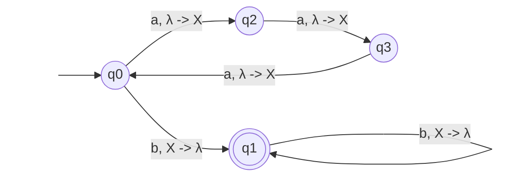

## 7.1 Exercises
1. Find a context-free grammar that doesn't use lambda that accepts the same language as the following CFG (except for the empty string).
𝑆→𝐵𝑆𝐴 | 𝐴
𝐴→ 𝑎𝐴 | 𝜆
𝐵→ 𝐵𝑏𝑎 | 𝜆
A and B are directly nullable, S is indirectly nullable through them
$a(𝐴 | 𝜆) = aA | a$
$(𝐵 | 𝜆)ba = Bba | ba$
$(B|λ)(S|λ)(A|λ)∣(A|λ) = BSA|BS|SA|BA|B|S|A|λ$
$= BSA|BS|SA|BA|B|A$
Final grammar:
$S \rightarrow BSA|BS|SA|BA|B|A$
$A \rightarrow aA|a$
$B \rightarrow Bba|ba$
2. Find a grammar that accepts the same language as the following CFG, but without unit productions.
𝑆→ 𝐴𝑆 | 𝐶
𝐴→ 𝑎𝐴 | 𝑏𝐵 | 𝐶
𝐵→ 𝑏𝐵 | 𝑏
𝐶→ 𝑐𝐶 | 𝐵
Unit closures:
S -> {S, A, B, C}
A -> {A, B, C}
B -> {B}
C -> {B, C}
Unit productions removed
S -> AS | cC | bB | b
A -> aA | bB | cC | b
B -> bB | b
C -> cC | bB | b

3. Convert the following grammar to Chomsky Normal Form (CNF).
𝑆→ 𝑎𝐴 | 𝐵𝐴𝑎
𝐴→ 𝐴𝐴 | 𝑎
𝐵→ 𝐴𝑏𝐵 | 𝑏
Create new variables to avoid mixing terminals and non-terminals
X -> a
Y -> b
S -> XA | BAX
A -> AA | a
B -> AYB | b
Break down chains of more than two on the right side by introducing more variables
W -> AX
Z -> YB
X -> a
Y -> b
S -> XA | BW
A -> AA | a
B -> AZ | b
4. Convert the grammar in Example 6–6 to CNF.
𝑆→ 𝑋𝑌
𝑋→ 𝑎𝑋𝑏 | 𝜆
𝑌→𝑎𝑌 | 𝜆
X and Y are directly nullable, S is indirectly nullable through them
$a(X | 𝜆)b = aXb | ab$
$a(Y | 𝜆) = aY | a$
$(X|λ)(Y|λ) = XY|X|Y|\lambda$
Eliminate unit productions S -> X and S -> Y
S -> XY | aXb | ab | aY | a | 𝜆
X -> aXb | ab
Y -> aY | a
Create new variables to avoid mixing terminals and non-terminals
A -> a
B -> b
S -> XY | ab | AY | a | 𝜆
X -> AXB | ab
Y -> AY | a
Introduce more variables to break down chains and so we have either exactly two variables or exactly one terminal
S -> XY | AB | AY | a | 𝜆
A -> a
B -> b
C -> AX
X -> CB | AB
Y -> AY | a
## 7.2 Exercises
1. Find CFGs for the following:
	a. The union of the languages in Examples 6–5 and 6–6.
	Example 6-5
	𝑆→𝑎𝑆𝑎 | 𝑏𝑆𝑏 | 𝑋
	𝑋→𝑎𝑌𝑏 | 𝑏𝑌𝑎
	𝑌→𝑎𝑌 | 𝑏𝑌 | 𝜆
	Example 6-6
	𝑆→𝑋𝑌
	𝑋→𝑎𝑋𝑏 | 𝜆
	𝑌→𝑎𝑌 | 𝜆

Start -> S1 | S2
𝑆1→𝑎𝑆1𝑎 | 𝑏𝑆1𝑏 | 𝑋1
𝑋1→𝑎𝑌1𝑏 | 𝑏𝑌1𝑎
𝑌1→𝑎𝑌1 | 𝑏𝑌1 | 𝜆
𝑆2→𝑋2𝑌2
𝑋2→𝑎𝑋2𝑏 | 𝜆
𝑌2→𝑎𝑌2 | 𝜆
	b. The concatenation of the languages in Example 6–5 and 6–6, in that order.
𝑆1→𝑎𝑆1𝑎 | 𝑏𝑆1𝑏 | 𝑋1
𝑋1→𝑎𝑌1𝑏 | 𝑏𝑌1𝑎
𝑌1→𝑎𝑌1 | 𝑏𝑌1 | S2
𝑆2→𝑋2𝑌2
𝑋2→𝑎𝑋2𝑏 | 𝜆
𝑌2→𝑎𝑌2 | 𝜆
	c. The Kleene star of the language in Example 6–5.
B (start) = BS | 𝜆
𝑆→𝑎𝑆𝑎 | 𝑏𝑆𝑏 | 𝑋
𝑋→𝑎𝑌𝑏 | 𝑏𝑌𝑎
𝑌→𝑎𝑌 | 𝑏𝑌 | 𝜆
2. Find a PDA for the intersection of the PDA in Figure 5–1 and the language of strings of a's and b's where the numbers of a's is a multiple of 3.
![[Pasted image 20260704111014.png]]
Figure 5-1: PDA accepting $\{a^n b^n\}, n > 0$

2. Are deterministic context-free languages closed under regular difference? Why or why not? (Note: The regular difference with a Context free language, C, and a Regular language, R, is C – R or R – C.)
Yes.
For C-R: Same as $C∩ \overline{R}$.  Because regular languages are closed under complement, $\overline{R}$ remains a regular language. Since DCFLs are closed under intersection with a regular language, the result is guaranteed to be a DCFL.
For R-C: Same as $R∩ \overline{C}$. DCFLs are closed under complement, meaning $\overline{C}$ is also a DCFL. Intersecting this new DCFL with the regular language $R$ once again results in a DCFL.
## 7.3 Exercises
1. Use the CYK algorithm to determine whether the grammar in Example 7–3 generates the string 𝑏𝑏𝑎𝑏. If it does, give a derivation.
	𝑆→𝑌𝐴 | 𝑋𝐵
	𝐴→𝑍𝐴 | 𝑋𝑆 | 𝑎
	𝐵→𝑊𝐵 | 𝑌𝑆 | 𝑏
	𝑋→𝑎
	𝑌→𝑏
	𝑍→𝑌𝐴
	𝑊→𝑋𝐵
Stage 1:
b: Y, B
a: X, A
Stage 2:
bb: impossible
ba: S, Z
ab: S, W
Stage 3:
bba: B
bab: B
Stage 4:
bbab: impossible
Because the grammar does not generate bbab, I cannot give a derivation.
2. Use the CYK algorithm to determine whether the grammar in Example 7–4 generates the string 𝑎𝑏𝑏𝑏. If it does, give a derivation.
	𝑆→𝑍𝑊 | 𝑍𝐴 | 𝑍𝐵 | 𝑋𝑌
	𝐴→𝑌𝑊 | 𝑌𝐴 | 𝑌𝐵 | 𝑏
	𝐵→𝑇𝑋 | 𝐵𝑋 | 𝐴𝑋 | 𝑎 | 𝑌𝑊 | 𝑌𝐴 | 𝑌𝐵 | 𝑏
	𝑋→𝑎
	𝑌→𝑏
	𝑍→𝑋𝑌
	𝑊→𝐴𝐵
	𝑇→𝐵𝐴
Stage 1:
a: B, X
b: Y, A, B
Stage 2:
ab: S, Z, T
bb: W, T, A, B
Stage 3:
abb: S, T
bbb: W, T, A, B
Stage 4:
abbb: S, T
Derivation:
S -> ZW -> XYW -> abW -> abAB -> abbB -> abbb
3. Does the following grammar generate any strings?
	𝑆→𝑋𝑌
	𝑋→𝑎𝑋
	𝐴→𝑎
	𝑌→𝐵𝑌 | 𝐵𝐵
	𝐵→𝑏
No, because S goes to X, which is trapped in an infinite series of as and has no way to escape.
4. Is the language of the following CFG finite or infinite?
	𝑆→𝐴𝐵 | 𝑎
	𝐴→𝐵 | 𝐵𝐵 | 𝐵𝐵𝐵 | 𝑏 | 𝑐
	𝐵→𝑎 | 𝑎𝑏 | 𝑎𝑏𝑐
Finite, because S can either go to A, B, or terminate. A can either go to B or terminate. B can only terminate. So the string must always terminate at some point.
5. Is the language of the following CFG finite or infinite?
	𝑆→𝑎𝐴 | 𝑏
	𝐴→𝐴𝐴𝑏
It is infinite, because although S can choose to terminate immediately, if it goes to A, it is stuck in an infinite loop of A -> AAb.
6. Is the language of the following CFG finite or infinite?
	𝑆→𝐴𝐵𝑎 | 𝑏𝐴𝑍 | 𝑏
	𝐴→𝑋𝑏 | 𝑏𝑍𝐴
	𝐵→𝑏𝐴𝐴
	𝑋→𝑎𝑍𝑎 | 𝑏𝐴 | 𝑎𝑎𝑎
	𝑍→𝑍𝐴𝑏𝐴
Infinite. Because S can go to A or Z, which are both recursive variables, it cannot be finite.