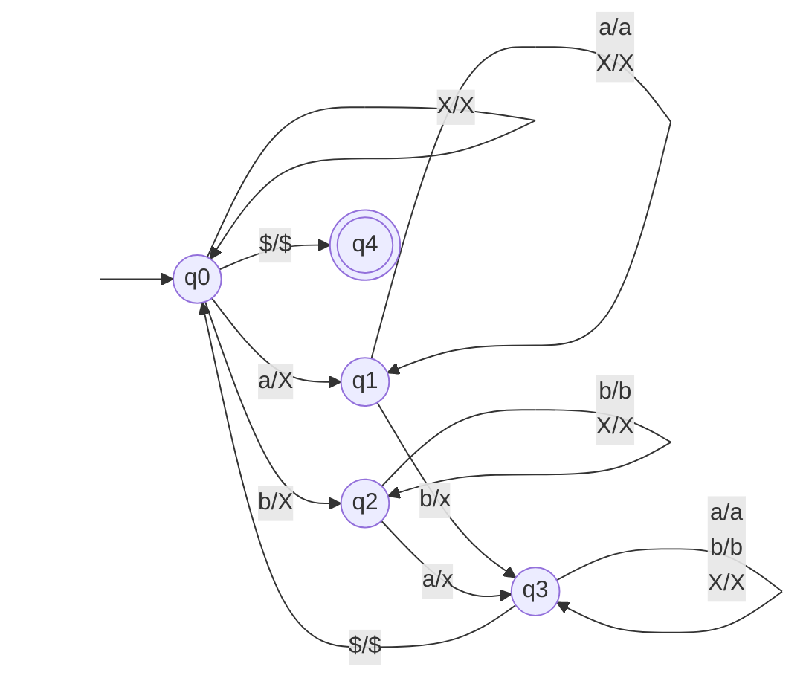
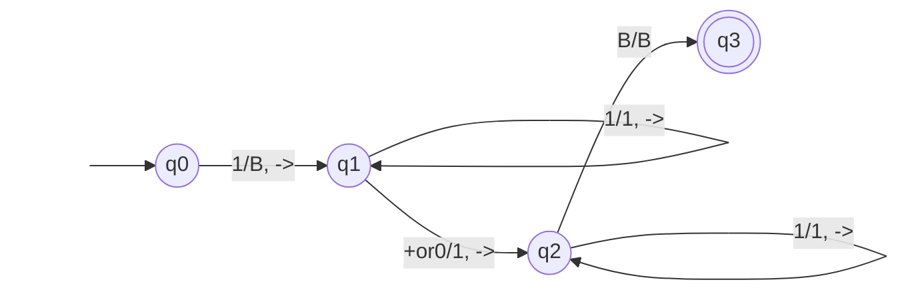
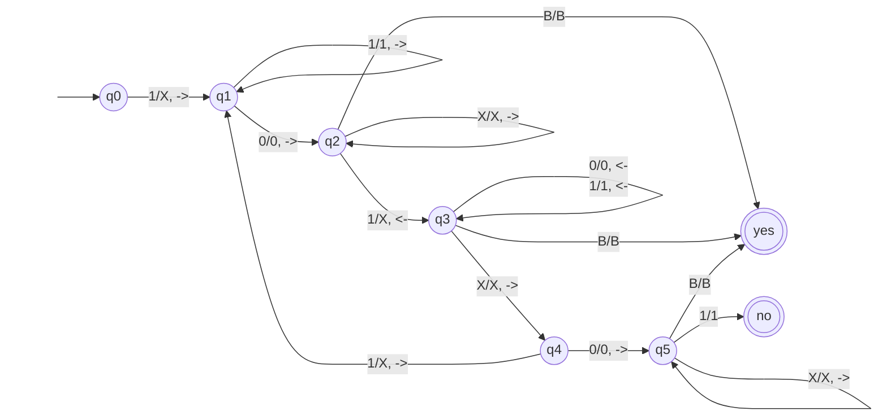
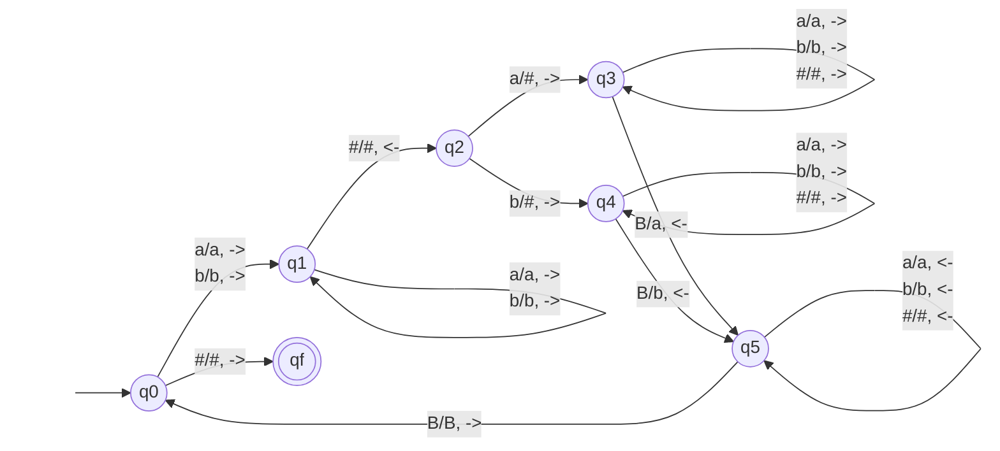
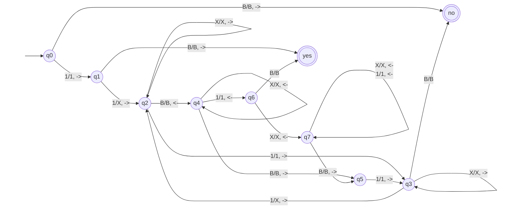

## Section 8.1 Exercises
1. Draw a Post (queue) machine that accepts 𝑛𝑎(𝑤) = 𝑛𝑏(𝑤) where 𝑤 ∈ (𝑎 + 𝑏)∗

## Section 8.2 Exercises
1. Construct a Turing machine that adds two unary numbers, as in Example 8–2, except that it erases the first 1 and changes the separating zero (except in the book it's a +) to a 1.

2. Draw a Turing machine that takes a string representing two unary numbers, 𝑥 and 𝑦, separated by a 0, and determines whether 𝑥 ≥ 𝑦. For example, the input for 𝑥 = 3, 𝑦 = 4 would be 11101111. Use two halt states: one for yes and one for no.

3. Give the trace of your machine in the previous problem processing the strings 1011 and 10.
String 1011:
start -> q0 **1**011
q0 -> q1 **X**011
q1 -> q2 X**0**11
q2 -> q3 X0**X**1
q3 -> q3 X**0**X1
q3 -> q4 **X**0X1
q4 -> q5 X**0**X1
q5 -> q5 X0**X**1
q5 -> no X0X**1**
No

String 10:
start -> q1 **1**0
q0 -> q1 **X**0
q1 -> q2 X**0**
q2 -> yes X0**B**
Yes

3. Draw a TM that computes f(w)=wR where w∈(a+b)*. For simplicity, you can use a delimiter and just copy the symbols backwards at the right, so, for example, abb# becomes abb#bba.

4. Draw a TM that accepts unary numbers representing powers of 2. (Hint: Except for 1 and 2, dividing powers of 2 by 2 always gives an even number.)

 